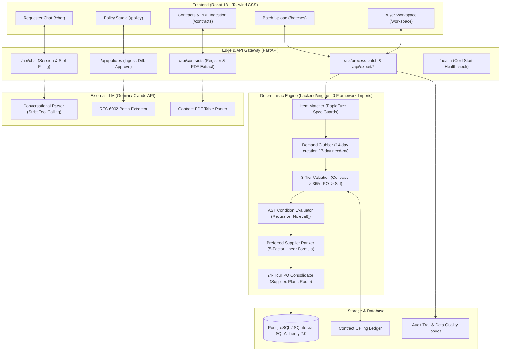

# Corvo Engineering - Autonomous Policy-Driven Procurement

A full-stack, policy-driven procurement engine that translates purchase requisitions (PRs) into purchase orders (POs) or competitive sourcing requests (RFQs/RFPs) in strict adherence to corporate policy rules, active rate contracts, supplier transaction histories, and 24-hour purchase order consolidation.

When procurement management uploads a new policy version or describes an amendment, the system updates how it decides **with zero code changes**.

---

## Architecture Overview



---

## One-Command Run (Local Docker Compose)

The repository is fully self-contained. Master data and policy v5.0 are included in `kit/` and are automatically seeded on first container boot.

```bash
# 1. Clone repository and navigate inside
cd Utsav_cantill

# 2. Copy the example environment file
cp .env.example .env

# 3. Build and launch all services (PostgreSQL + FastAPI + React SPA)
docker compose up --build
```

- **Web Application & UI:** [`http://localhost:8000`](http://localhost:8000)
- **API Documentation (Swagger):** [`http://localhost:8000/docs`](http://localhost:8000/docs)
- **Healthcheck Endpoint:** [`http://localhost:8000/health`](http://localhost:8000/health)

---

## Hosted Cloud Deployment

- **Live Application URL:** `https://corvo-procurement.onrender.com` *(Replace with your deployed Render URL)*
- **Health Check / Cold Start Monitor:** `https://corvo-procurement.onrender.com/health`

> **Note on Cold Starts:** Free-tier instances on Render/Railway spin down after inactivity. The first request may take 30–50 seconds to initialize. The `/health` endpoint can be pinged by uptime monitors to maintain a warm instance. Master data and active policies are persisted in managed PostgreSQL and are never wiped on container restarts or redeploys.

---

## Demo Credentials & Role Switcher

No passwords are required for the evaluation demo. A role switcher is permanently visible in the top navigation header alongside the active policy version badge:

| Role | Intended Permissions & Primary Screen | Primary Actions Available |
|---|---|---|
| **Requester** | Natural language requisition intake (`/chat`) | Chat slot-filling, pick item candidates, confirm & generate draft PRs |
| **Buyer** | Operational requirements table (`/workspace`) | Review clubbed PRs, inspect "Why" drawer, approve POs, record overrides |
| **Procurement Admin** | Policy management & governance (`/policy`, `/contracts`, `/audit`) | Ingest policy amendments, review plain-English diffs, activate versions |

---

## Running the Automated Test Suites

### 1. Backend Regression Tests (Pytest)
Executes **99 unit & integration tests**, including all 14 official Worked Examples from `kit/Worked_Examples.pdf` running against real master data:
```bash
./venv/bin/pytest tests/ -v
```

### 2. Frontend End-to-End Smoke Tests (Playwright)
Executes 3 automated browser user journeys (Chat-to-PR, Batch-to-Approve, Policy-to-Activate):
```bash
cd frontend
./node_modules/.bin/playwright test
```

### 3. Policy Amendment Rehearsal Script
Executes an automated rehearsal that applies 3 synthetic amendments (limit change, plant-specific override, and category-level RFQ rule) without touching code:
```bash
./venv/bin/python backend/scripts/rehearse_amendments.py
```

### 4. Standalone Batch CLI
Process any batch CSV offline directly from terminal:
```bash
python -m backend.app.cli process kit/sample_pr_batch.csv decisions_output.csv
```

---

## Blind-Test Runbook (Step-by-Step)

Follow this exact protocol during the assessment blind test.

### Run 1: Baseline Processing Under Policy v5.0

1. **Open the Application:** Navigate to [`http://localhost:8000`](http://localhost:8000) (or your hosted URL).
2. **Verify Active Policy:** Confirm the header displays the green badge: **`Policy Active: v5.0`**.
3. **Upload the Sample Batch:**
   - Click **Batches** in the top navigation (`/batches`).
   - Drag and drop `kit/sample_pr_batch.csv` (or click to browse).
   - Click the primary button: **"Process Batch"**.
4. **Inspect Processing Summary:**
   - 186 total requisition lines are ingested and evaluated.
   - 0 blocked suppliers are awarded orders or suggested.
   - Defective rows (`PUN2`, zero quantity) are flagged as `NOT_PROCESSED` with audit explanations.
5. **Review in Buyer Workspace:**
   - Click **Buyer Workspace** (`/workspace`).
   - Click any row to open the **"Why" Drawer**:
     - View the matched policy clause (e.g. `Clause 5.2 (Rate Contract)` or `Clause 5.4 (Spot PO)`).
     - Inspect the contract ceiling progress bar (`consumed / ceiling`).
     - Examine the preferred supplier score breakdown (Frequency 30%, Recency 25%, Contract 20%, OTD 15%, Quality 10%).
6. **Export Decision Reports:**
   - In the Buyer Workspace, click **"Export Decisions CSV"** to download `decisions.csv` with exact 13-column schema:
     `pr_no, pr_line, resolved_item_code, group_id, po_id, decision, route, supplier_id, unit_price, group_value_inr, suggested_supplier_ids, policy_version, reason`.
   - In **Preferred Suppliers** (`/preferred`), click **"Export Preferred Suppliers CSV"** to download the top 3 ranked vendors per item.

---

### Run 2: Policy Amendment & Batch Reprocessing

1. **Navigate to Policy Management:**
   - Switch role to **Procurement Admin** in the header.
   - Click **Policy** in navigation (`/policy`).
2. **Submit an Amendment:**
   - Option A (Text instruction): Enter:
     > *"Raise the spot PO limit to 3 lakh for plant CHK1 only effective from 2026-11-01"*
   - Option B (Document upload): Upload an amendment PDF or text file.
   - Click **"Ingest Amendment"**.
3. **Review Plain-English Diff & Impact Preview:**
   - Verify the structural diff renders in plain language:
     > *"Rule 5.4 (Spot PO): max_value changes from Rs 2,00,000 to Rs 3,00,000 for plant CHK1 only."*
   - Verify the **Impact Preview** table indicates how many requisition lines migrate from `RFQ` to `SPOT_PO`.
4. **Approve and Activate:**
   - Click **"Approve & Activate Amendment"**.
   - The version auto-increments to **`v5.1`** with status `ACTIVE`.
5. **Reprocess Batch Under `v5.1`:**
   - Return to **Batches** (`/batches`) and click **"Reprocess Latest Batch"** (or re-upload the CSV).
   - Switch to **Buyer Workspace** (`/workspace`).
   - Verify requirements for plant `CHK1` between ₹2,00,000 and ₹3,00,000 now route directly to `SPOT_PO` instead of `RFQ`.
6. **Export Amended Decisions:**
   - Click **"Export Decisions CSV"** and verify `policy_version` records `v5.1`.

---

## Technical Documentation
- **[APPROACH.md](APPROACH.md):** Architectural methodology, AI vs. deterministic boundaries, and tools used.
- **[DECISIONS.md](DECISIONS.md):** Complete engineering ledger covering data quirks, policy ambiguities, ranking weights, not-processed rules, and amendment versioning.
